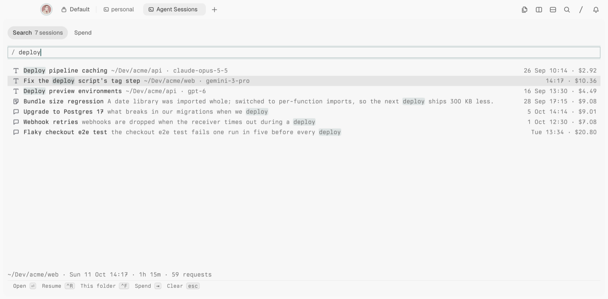
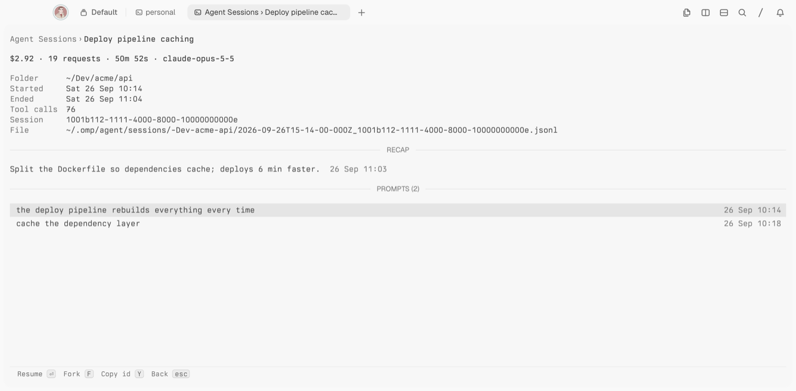
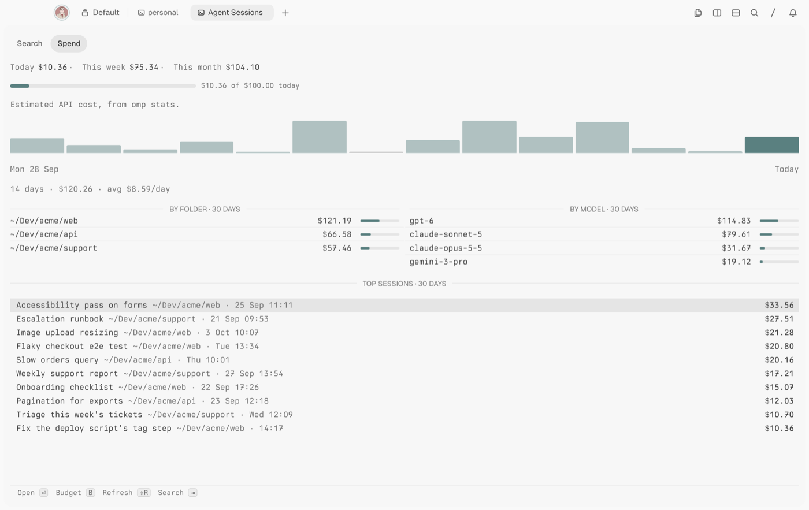

# Agent Sessions _(tern-sessions)_

Search your past [omp](https://github.com/can1357/oh-my-pi) sessions from [Tern](https://stencil.so/tern), resume or fork one in a new tab, and see what they cost.



Type a few words and Agent Sessions finds the sessions where they appear in the title, a recap, or one of your prompts. Press `ctrl+r` to resume the session in a new tab, in its own folder. The **Spend** tab adds up what omp has cost today, this week and this month, and can warn you when a day goes over budget. Costs are estimated API costs from `omp stats`.

It reads omp's own history and stats databases. Nothing is indexed or copied, so results are there as soon as omp writes them.

## Install

Needs Tern 0.8 or later on macOS or Linux (not Windows), [omp](https://github.com/can1357/oh-my-pi), and `sqlite3` (included with macOS; on Linux, `sudo apt install sqlite3`).

```sh
tern plugin install github.com/bmanturner/tern-sessions
```

Press `ctrl+alt+shift+h`, or run **Agent Sessions: Search sessions** from the palette. **Agent Sessions: Show spend** opens the Spend tab. To update, run the install command again with `--force`.

## Search

| You type | It finds |
| --- | --- |
| `deploy script` | Sessions mentioning both words in the title, a recap or a prompt |
| `"tag step"` | That exact phrase |
| `repo:api` | Sessions whose folder contains `api` |
| `model:opus` | Sessions that used a matching model |
| `after:2026-10-01`, `before:2026-10-08` | Sessions started in that range |
| `cost>5`, `cost<1` | Sessions that cost more or less than that many dollars |

Title matches come first, then recaps, then prompts. Only your own prompts are searchable; what the agent wrote isn't. Filters are highlighted in the field; an invalid one is underlined and ignored, with a note. If you type and press `enter` right away, it acts on the new results.

| Key | Does |
| --- | --- |
| `↑` `↓` | Select a session |
| `page up` `page down`, `home` `end` | Jump through the list |
| `enter` | Open its details |
| `ctrl+r` | Resume it in a new tab |
| `ctrl+f` | Show only sessions from this folder |
| `tab` | Switch to Spend |
| `esc` | Clear the search |

The details show the session's folder, times, cost (including its subagents), tool calls, session id, file, recaps and your first 30 prompts. Press `enter` or `r` to resume it, `f` to fork it (a copy that continues on its own), `y` to copy its id, or `esc` to go back. The arrows scroll the prompts, and clicking a prompt copies it.



## Spend



Spend shows today, this week (from Monday) and this month, and a bar per day for the last two weeks (today highlighted, days over budget in amber). Below are costs by folder and by model with a share bar, and the ten costliest sessions of the last 30 days.

| Key | Does |
| --- | --- |
| `enter` | Open the selected session |
| `b` | Set the daily budget |
| `shift+r` | Refresh (runs `omp stats --summary` first) |
| `tab` `esc` | Back to Search |

The budget dialog has Save and Cancel buttons too. Once a day goes over the budget, you get one desktop notification. Tern checks within 5 minutes (first shortly after it starts) while its session service is running. Set the budget to 0 to turn alerts off.

## Good to know

- **No stats yet?** omp keeps costs in `~/.omp/stats.db`, which it creates the first time you run `omp stats`. Until then, search works without costs or models, and Spend asks you to run it.
- **Resume** opens the session in the folder it ran in. If that folder is gone, it opens in your home folder and tells you so.
- **Privacy:** Agent Sessions only reads omp's files, keeps a few settings in Tern's plugin data folder, and makes no network requests.

To uninstall, run `tern plugin remove tern-sessions`.

## Develop

```sh
git clone https://github.com/bmanturner/tern-sessions
cd tern-sessions
tern plugin link .   # Tern reloads the plugin when a file changes
bun install && bun run test
```

The queries live in `lib/query.luau` and run through the system `sqlite3` (`lib/db.luau`). `bun run test` checks the search syntax and runs every query against fixture databases with omp's schema. `bun test/fixtures.ts --demo <dir>` writes the demo data used for the screenshots.

## License

[MIT](LICENSE)
